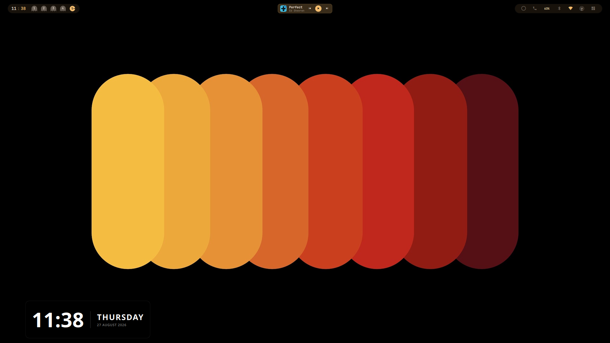
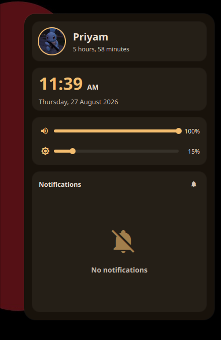
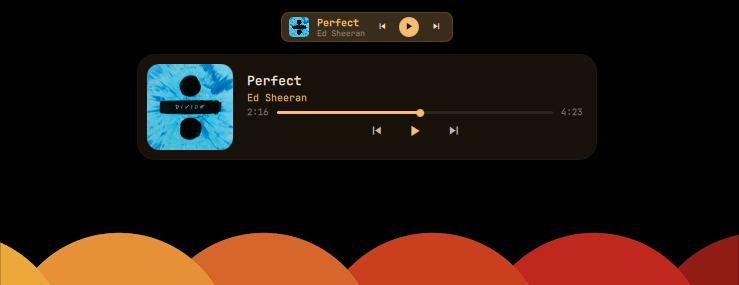
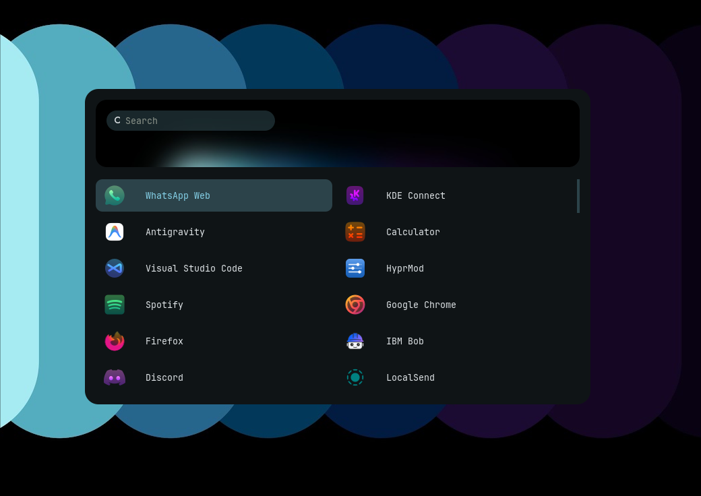

# Hyprland + Quickshell Dotfiles

> My personal Arch Linux + Hyprland desktop configuration — built around Quickshell, dynamic Matugen theming, custom widgets, and a keyboard-driven workflow.

<p align="center">
  
</p>

<p align="center">
  <b>Hyprland</b> ·
  <b>Quickshell</b> ·
  <b>Matugen</b> ·
  <b>Wayland</b> ·
  <b>Arch Linux</b>
</p>

---

## ✦ About

This repository contains my personal **Hyprland rice** running on Arch Linux.

The setup combines a tiling Wayland compositor with a custom Quickshell interface, dynamic wallpaper-based theming, media controls, system drawers, and various utilities.

The idea is simple:

> **Keep the desktop minimal, but make everything I use frequently accessible in a single workflow.**

---

## ✨ Features

### 🖥️ Custom Quickshell UI

A collection of custom QML widgets and panels for everyday desktop interactions.

- Status bar
- Control dashboard
- Media player
- Wi-Fi panel
- Bluetooth panel
- KDE Connect panel
- Wallpaper selector
- GitHub monitor
- PDF tools
- Calendar
- System tray

### 🎨 Dynamic Theming

The desktop uses **Matugen** to generate colors from the current wallpaper.

```text
           Wallpaper
               │
               ▼
            Matugen
               │
       ┌───────┼────────┐
       ▼       ▼        ▼
   Hyprland  Kitty     Rofi
       │
       ├──── Cava
       │
       └──── Quickshell
```

Changing the wallpaper automatically updates the generated color configuration across the desktop.

### 🎵 Media Controls

The Quickshell media widget provides:

- Album artwork
- Track information
- Playback controls
- Track progress
- Seeking
- MPRIS source selection

### 📡 System Integration

Quick-access drawers are available for:

- Wi-Fi
- Bluetooth
- KDE Connect
- System controls

### 📸 Screenshot & Clipboard Tools

Screenshot tools:

```text
grim → slurp → swappy
```

Clipboard workflow:

```text
wl-clipboard → cliphist → Rofi
```

---

## 📷 Screenshots

### Main Desktop

<p align="center">
  
</p>

### Control Dashboard

<p align="center">
  
</p>

### Media Player

<p align="center">
  
</p>

### Application Launcher

<p align="center">
  
</p>

---

## 🧩 Components

| Component | Used for |
|---|---|
| **Hyprland** | Wayland compositor |
| **Quickshell** | Desktop shell & widgets |
| **Matugen** | Dynamic color generation |
| **Kitty** | Terminal |
| **Rofi** | Application launcher & utilities |
| **Hyprlock** | Lock screen |
| **Hypridle** | Idle management |
| **Wlogout** | Power menu |
| **Cava** | Audio visualizer |
| **awww** | Wallpaper daemon |
| **KDE Connect** | Device integration |
| **Cliphist** | Clipboard history |
| **SwayOSD** | Volume & brightness HUD |

---

## 📁 Structure

```text
dotfiles/
│
├── .config/
│   ├── hypr/
│   ├── quickshell/
│   ├── kitty/
│   ├── rofi/
│   ├── wlogout/
│   ├── cava/
│   └── matugen/
│
├── Pictures/
│   └── wallpapers/
│
├── screenshots/
│
├── .zshrc
├── install.sh
├── packages.txt
├── .gitignore
└── LICENSE
```

---

## 🚀 Installation

> **Note:** These dotfiles are primarily designed for my Arch Linux setup. Review the configuration and packages before installing them on another system.

### 1. Clone

```bash
git clone https://github.com/Priyam792/arch-hyprland-dotfiles.git
cd arch-hyprland-dotfiles
```

### 2. Run the installer

```bash
chmod +x install.sh
./install.sh
```

The installer will:

- Check for required packages
- Offer to install missing dependencies
- Back up existing configurations
- Create the required symlinks
- Set up the default wallpaper

Existing configurations are backed up to:

```text
~/.config/dotfiles_backup_<timestamp>/
```

### 3. Start Hyprland

Log into your Hyprland session and reload your shell:

```bash
source ~/.zshrc
```

To reload Hyprland:

```bash
hyprctl reload
```

---

## 📦 Dependencies

### Required

**Official repositories**

```text
hyprland
hyprlock
hypridle
kitty
rofi
matugen
awww
pipewire-utils
wireplumber
brightnessctl
jq
curl
python
```

**AUR**

```text
quickshell-git
```

### Optional

Install these depending on the features you want:

```text
cliphist
wl-clipboard
wlogout
cava
grim
slurp
swappy
network-manager-applet
blueman
bluez-utils
kdeconnect
zenity
socat
starship
```

**AUR**

```text
swayosd-git
omniglyph
```

---

## ⌨️ Keybindings

| Keybind | Action |
|---|---|
| `Super + Q` | Kitty Terminal |
| `Super + E` | File Manager |
| `Super + B` | Zen Browser |
| `Super + Z` | Zed Editor |
| `Super + R` | Rofi Launcher |
| `Alt + V` | Clipboard History |
| `Super + Escape` | Power Menu |
| `Super + A` | Wallpaper Panel |
| `Super + N` | Control Dashboard |
| `Super + X` | Media Player |
| `Super + D` | PDF Tools |
| `Super + G` | GitHub Monitor |
| `Alt + W` | Wi-Fi Panel |
| `Alt + B` | Bluetooth Panel |
| `Alt + K` | KDE Connect |
| `PrintScreen` | Area Screenshot |
| `Shift + PrintScreen` | Fullscreen Screenshot |

---

## 🎨 Customization

### Wallpaper

Use:

```text
Super + A
```

to open the wallpaper panel.

Matugen then generates the corresponding color configuration for the supported applications.

### Monitor Configuration

Monitor settings can be changed in:

```text
.config/hypr/monitors.conf
```

Example:

```ini
monitor = eDP-1, 1920x1080@144, 0x0, 1
```

Change this according to your monitor configuration.

---

## 🔧 Troubleshooting

### Quickshell isn't starting

Check the user service logs:

```bash
journalctl --user -u quickshell
```

If the shell starts but some components are blank, check that the required environment configuration is being loaded by Hyprland.

### Media controls aren't updating

Make sure `playerctld` is running:

```bash
systemctl --user enable --now playerctld
```

### Wi-Fi / Bluetooth drawers are empty

Check the required services:

```bash
systemctl status NetworkManager
systemctl status bluetooth
```

Enable them if necessary:

```bash
sudo systemctl enable --now NetworkManager
sudo systemctl enable --now bluetooth
```

---

## 🧹 Uninstallation

The installer creates backups before replacing existing configurations.

Remove the created symlinks:

```bash
rm -rf ~/.config/{hypr,quickshell,kitty,rofi,wlogout,cava,matugen} ~/.zshrc
```

Then restore your previous configuration from:

```text
~/.config/dotfiles_backup_<timestamp>/
```

> Check the backup before deleting or replacing anything.

---

## 🤝 Credits

This setup has been built through personal experimentation, customization, debugging, and iteration.

Development assistance and brainstorming were also done with **Antigravity**.

The configuration also takes inspiration from the wider Linux, Hyprland, Quickshell, Wayland, and ricing communities.

---

## 📜 License

This project is licensed under the **MIT License**.

See [`LICENSE`](LICENSE) for details.

---

<p align="center">

🐧 **Arch Linux + Hyprland + Quickshell**

Built with ☕ and an unreasonable amount of time spent tweaking dotfiles.

⭐ If you like the setup, consider starring the repository.

</p>
